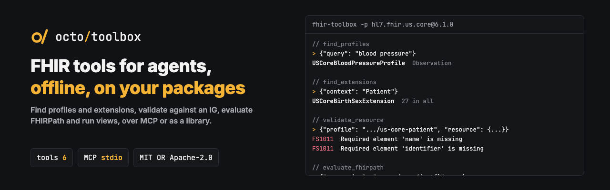

<p align="center"></p>

<p align="center"><b>FHIR tools for agents, offline: find profiles and extensions, validate against an IG, evaluate FHIRPath, run views.</b></p>

<p align="center">
  <a href="https://github.com/octofhir/fhir-toolbox/actions/workflows/ci.yml"></a>
  <a href="https://crates.io/crates/fhir-toolbox"></a>
  <a href="https://docs.rs/fhir-toolbox"></a>
  <a href="#license"></a>
</p>

An agent working with FHIR needs the definitions of the implementation guide in front of it, and a
way to check what it writes. `fhir-toolbox` gives it both over the Model Context Protocol, with no
server and no network once the packages are installed.

```sh
fhir-toolbox --package hl7.fhir.us.core@6.1.0
```

A package is `name@version`, installed from the FHIR package registry with its dependencies when it
is missing, or a folder. `--fhir` picks the core version: `r4` by default, `r4b`, `r5` or `r6`.

To use it from an MCP client, run it as a stdio server:

```json
{"mcpServers": {"fhir": {"command": "fhir-toolbox", "args": ["-p", "hl7.fhir.us.core@6.1.0"]}}}
```

## Tools

| Tool | What it does |
|---|---|
| `find_profiles` | Profiles in the packages, by words and by the type they constrain |
| `find_extensions` | Extensions, by words and by where they may be used |
| `describe_profile` | The differential of a profile or extension, element by element |
| `validate_resource` | Validation against FHIR, and a profile when given |
| `evaluate_fhirpath` | A FHIRPath expression, on a resource when given |
| `run_view` | A SQL on FHIR ViewDefinition over resources, as rows |

`validate_resource` does not check code bindings: that takes a terminology server, and the toolbox
stays offline.

## As a library

[`Toolbox`](https://docs.rs/fhir-toolbox) depends on no transport, so a FHIR server can offer the same
tools next to its own:

```rust,no_run
use fhir_toolbox::Toolbox;
use octofhir_fhirschema::FhirVersion;
use serde_json::json;

# async fn run() -> Result<(), fhir_toolbox::Error> {
let toolbox = Toolbox::builder(FhirVersion::R4)
    .package("hl7.fhir.us.core@6.1.0")
    .build()
    .await?;
let found = toolbox
    .call("find_profiles", &json!({"query": "blood pressure"}))
    .await?;
# Ok(())
# }
```

## License

MIT or Apache-2.0, at your option.
